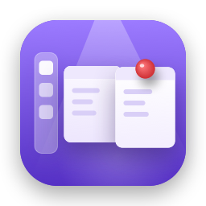
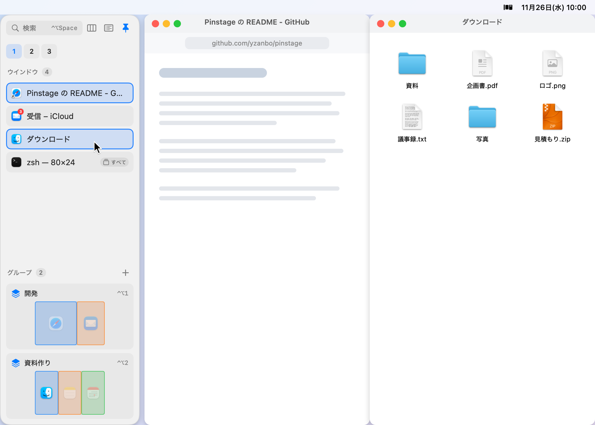
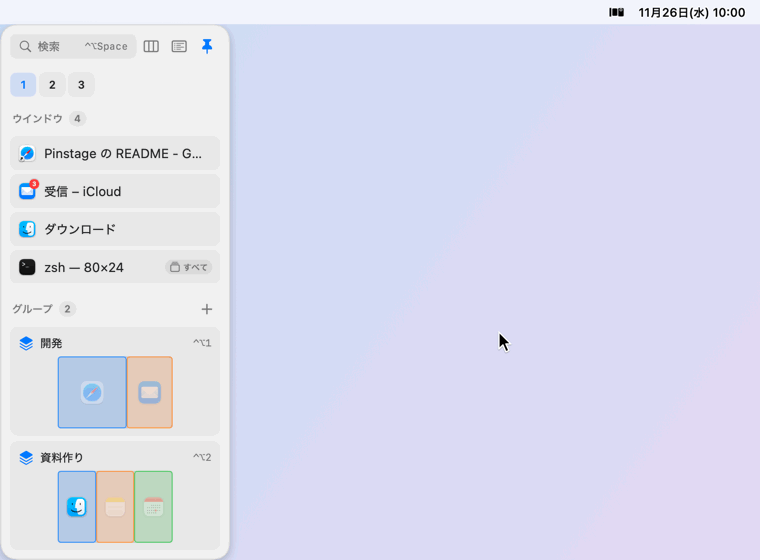
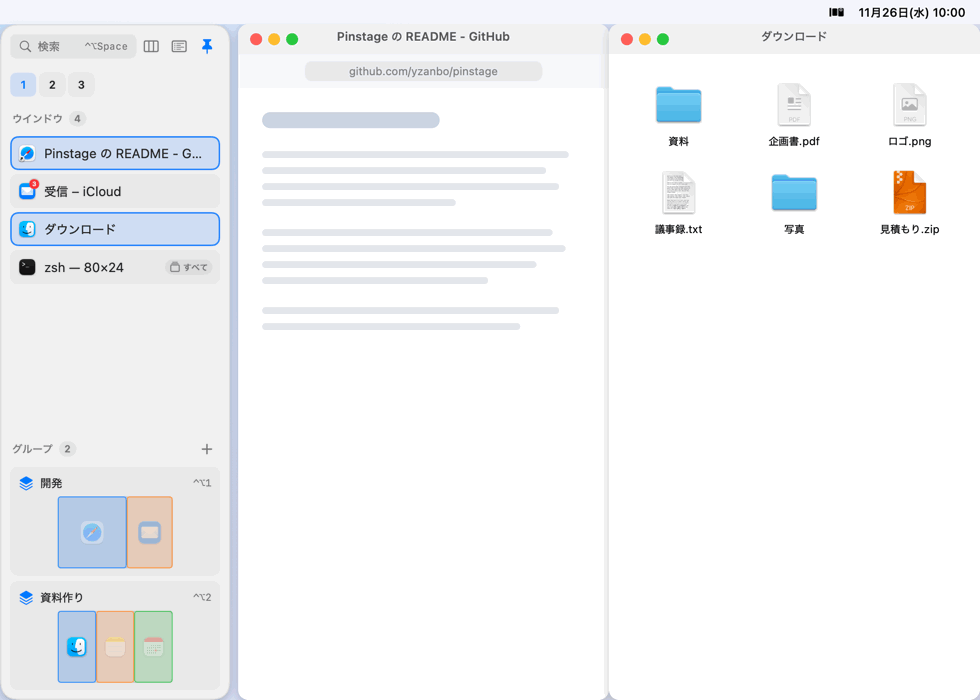

<p align="center">
  
</p>

<h1 align="center">Pinstage</h1>

<p align="center">
  見たいウインドウだけを、グループを作らずにその場で並べて最前面に出せる macOS のメニューバーアプリ
</p>

<p align="center">
  <a href="LICENSE"></a>
  
  
</p>

<p align="center">
  
</p>

> [!NOTE]
> **いまは β 版です**（最新の版は [Releases](https://github.com/yzanbo/pinstage/releases) を見てください）。思わぬ不具合があるかもしれません。見つけたら [Issues](https://github.com/yzanbo/pinstage/issues) で教えてください。操作や設定の保存形式は、正式版までに変わることがあります。

> **English:** Pinstage is a macOS menu bar app that lets you pick just the windows you want to see and tile them in front, without first sorting them into groups. A window bar on any edge of the screen lists your windows; click, ⌘-click, or drag them out to bring them to the front and arrange them side by side. Save combinations as groups and recall them later. The UI is currently in Japanese.

## ステージマネージャとの違い

ステージマネージャでは、ウインドウはどれか 1 つのグループに属します。横に並べて比べるには、先にグループにまとめる必要があり、まとめると元のグループから抜けてしまいます。

Pinstage では、ウインドウバーで選んだウインドウが、そのまま**ステージ**に出て並びます。ウインドウはどのグループにも縛られません。比べたいウインドウを選ぶだけで並べられ、保存したグループは変わりません。ステージは、ウインドウを並べる場所で、画面からメニューバー・Dock・ウインドウバーを除いた残りです。

## 使い方

1. **出す**：ウインドウバーの行をクリックすると、そのウインドウだけがステージに出ます。⌘＋クリックすると横に足して、選んだウインドウを並べます（行をウインドウバーの外へドラッグしても足せます）。ステージに出ているウインドウの行には、青い枠が付きます

   <p align="center">
     
   </p>

2. **とっておく**：並べた組み合わせは、グループの見出しの ＋ から「ステージをグループとして保存」すると、並べ方と一緒に保存できます。ウインドウバーのグループの行を押すか、⌃⌥1〜9 で呼び出せます

   <p align="center">
     
   </p>

3. **切り替える**：⌥Tab で、ウインドウスイッチャーが開きます。デスクトップごとにウインドウが並び、選ぶまではデスクトップを切り替えません。スペースで複数を選んで ↩ を押すと、選んだウインドウをステージに並べます

   <p align="center">
     
   </p>

## できること

- **ウインドウバー**：画面の端（左・右・上・下）に、いまのデスクトップのウインドウとグループを並べます。見た目はアイコンの並び・一覧・サムネイルから選べ、「常に出す」か「自動で隠す」にできます
- **その場で並べる**：クリックでそのウインドウだけを出し、⌘＋クリックかウインドウバーの外へのドラッグで横に足します。ダブルクリックでステージいっぱいに広げます
- **並べ方**：自動・左右・上下・4 分割・6 分割・左を大きく、から選べます。編集画面で、自分の型も作れます
- **グループ**：組み合わせを並べ方と一緒に保存し、ウインドウバーや ⌃⌥1〜9 で呼び出せます。自分で整えた画面を、位置・大きさごと記録することもできます
- **ウインドウスイッチャー**：⌥Tab で、デスクトップごとにウインドウを並べた切り替え画面を開きます。複数を選んで、まとめてステージに並べることもできます
- **検索**：⌃⌥Space で、ウインドウ名・アプリ名・グループ名から探せます
- **デスクトップ・ディスプレイごと**：ウインドウバーとステージは、デスクトップ・ディスプレイごとに分かれます。行を別のディスプレイのウインドウバーへドラッグすると、そのディスプレイへ移せます
- **アプリのバッジ**：未読数などの Dock のバッジを、ウインドウバーとウインドウスイッチャーにも出します。アプリ独自のバッジも出せます（[docs/BADGES.md](docs/BADGES.md)）
- **ショートカットと自動化**：ショートカットは設定で割り当て直せます。macOS の「ショートカット」アプリや、`pinstage://` の URL からも操作できます
- **再起動しても残す**：グループ・型・ウインドウの並び順を覚えておきます。ログイン時に起動もできます

くわしい操作は [docs/USAGE.md](docs/USAGE.md)、くわしい構成は [docs/ARCHITECTURE.md](docs/ARCHITECTURE.md)、手で確かめる項目は [docs/TESTING.md](docs/TESTING.md) を見てください。

## ダウンロード

[Releases](https://github.com/yzanbo/pinstage/releases) から `Pinstage-<版>.dmg` をダウンロードして開き、`Pinstage` を `Applications`（アプリケーションフォルダ）へドラッグしてください（`.zip` もあります。展開して `Pinstage.app` を入れる形で、中身は同じです）。macOS 26 以降で、Intel と Apple Silicon のどちらの Mac でも動きます。

Apple の公証を受けていない（アドホック署名の）アプリなので、初めて開くときに「開発元を確認できない」と止められます。次のどちらかで開けます。

- 一度開こうとしたあと、システム設定 →「プライバシーとセキュリティ」の下の方にある「このまま開く」を押す
- ターミナルで `xattr -dr com.apple.quarantine /Applications/Pinstage.app` を実行してから開く

開くと「アクセシビリティ」の許可を求められます。システム設定で Pinstage をオンにしてください（ほかのアプリのウインドウを動かす・前に出すために使います）。形式を「サムネイル」にしたときだけ、「画面収録」の許可も求められます。新しい版に入れ替えたときは、これらの許可を取り直す必要があります（一覧の古い Pinstage を「−」で消してから、もう一度許可してください）。

メニューバーに Pinstage のアイコンが出て（Dock には出ません）、画面の左端にウインドウバーが出ます。macOS のステージマネージャはオフにしてください（オンだと、並べたとおりになりません）。

## ソースからビルド

### 用意するもの

- macOS 26 以降
- Xcode 26 以降
- [XcodeGen](https://github.com/yonaskolb/XcodeGen)（`brew install xcodegen`）

### 手順

```bash
make cert   # 開発用の署名の証明書「Pinstage Dev」を作る（一度だけ。パスワードを聞かれる）
make run    # ビルドして起動する
```

初めて起動すると、アクセシビリティの許可を求められます。ほかのアプリのウインドウを動かすために使います。システム設定 →「プライバシーとセキュリティ」→「アクセシビリティ」で Pinstage をオンにしてください。

形式を「サムネイル」にしたとき（ウインドウバーの見出しのボタンか、メニューバー → 設定… →「形式」）は、画面収録の許可も求められます。許可したあと、Pinstage を開き直してください。

`make cert` で作った証明書で署名すると、ビルドし直しても同じアプリと見なされ、アクセシビリティと画面収録の許可が外れません。証明書がないとアドホック署名になり、ビルドし直すたびに許可を取り直す必要があります（一覧の古い Pinstage を「−」で削除してから、もう一度許可してください）。

| コマンド | すること |
|---|---|
| `make run` | Debug でビルドして起動する |
| `make test` | PinstageCore のテストを動かす |
| `make install` | Release でビルドして `/Applications` に入れる |
| `make dist` | Releases に置く DMG と zip（`dist/Pinstage-<版>.dmg`・`.zip`・`.sha256`）を作る（アドホック署名） |
| `make publish` | DMG と zip を作り、GitHub に Release（タグ `v<版>`）を作ってアップロードする。β 版は `make publish BETA=1`（タグ `v<版>-beta.1`・プレリリース）。説明は `scripts/release-changes.md`（出すたびに書き直す）と `scripts/release-notes.md` をつなげる |
| `make stop` | 動いている Pinstage を終了する |
| `make cert` | 開発用の署名の証明書を作る |
| `make preview` | ウインドウバー・編集画面・検索・設定の見た目を、見本のデータで画像に描き出す（`build/preview`。本物の設定は読まない・書き換えない） |
| `make readme-images` | README の見本の画像（`docs/images/`）を作り直す（ウインドウバー・ウインドウスイッチャーの見た目を変えたとき。見本のデータで描くので、画面には何も出ない） |
| `make icon` | アイコンを描き直す（`scripts/make-app-icon.swift` を変えたとき） |

不具合の報告や提案は [Issues](https://github.com/yzanbo/pinstage/issues) へどうぞ。

## ライセンス

[PolyForm Shield License 1.0.0](LICENSE)

Pinstage のソースコードは公開していますが、オープンソースのライセンスではありません。使う・改変する・配ることはできますが、Pinstage と競合する製品（または、作者が Pinstage を使って提供する製品と競合する製品）を提供するために使うことはできません。正確な条件は、[ライセンスの本文](LICENSE)（英語）を見てください。
